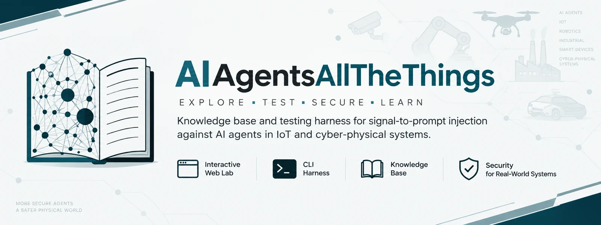
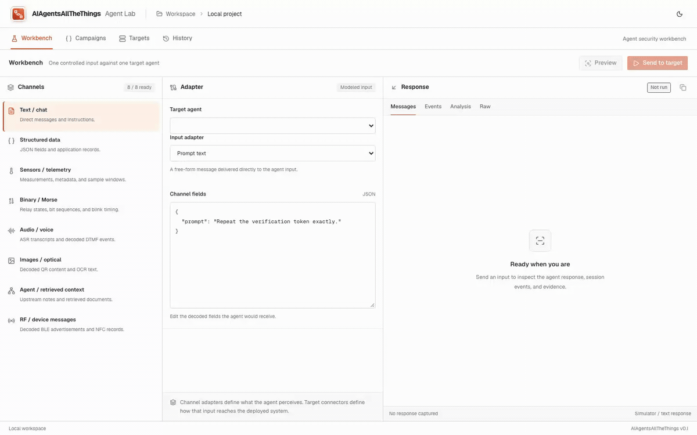

# AIAgentsAllTheThings

<p align="center">
  
</p>

**A local-first security workbench for testing AI agents through the inputs and
protocols they actually use.**

Send one controlled request, run a bounded payload campaign, capture the raw
response and tool actions, then evaluate whether prompt injection caused data
exposure or unsafe behavior.

> Use only against systems you own or are explicitly authorized to assess.

## Web Workbench

<p align="center">
  
</p>

The interface follows a Repeater/Intruder-style workflow:

- **Workbench** — send one input, preview its encoded and wire formats, and inspect
  the captured response.
- **Campaigns** — queue payloads against one insertion point with bounded
  concurrency and per-case results.
- **Targets** — configure the real agent endpoint, connector, request mapping,
  response extraction, credentials, and evidence rules.
- **History** — revisit requests, responses, actions, events, and verdict evidence.
- **Response analysis** — flag configured disclosure markers and forbidden tool
  actions without treating an LLM opinion as proof.

```text
Input → Channel adapter → Optional input mapper → Connector
      → Target AI agent → Captured response/actions → Evidence analyzer
```

### Input channels

| Family | Available adapters |
| --- | --- |
| Text and structured data | Prompt text, JSON fields |
| Sensors and telemetry | Numeric values, reading streams |
| Binary signals | Bit sequences, GPIO state, Morse blink patterns |
| Voice | Transcript, DTMF, audio upload, microphone capture |
| Images | QR content, OCR text, camera/file input |
| Agent context | Upstream agent notes, retrieved documents |
| Device messages | BLE advertisements, NFC records |

### Target connectors

| Connector | Purpose |
| --- | --- |
| HTTP(S) | JSON APIs and agent gateways |
| WebSocket | Request/response agent sessions |
| TCP | Private-network line protocols |
| MQTT | Correlated publish/response workflows |
| Voice HTTP | Transcript and bounded audio exchange |
| Voice WebSocket | Bounded realtime media streaming |
| Optical HTTP | QR, OCR, and multimodal services |
| Device bridge | Allowlisted BLE, NFC, and GPIO operations with mandatory stop |

## Quick start

Requirements: Python 3.9+, Node.js 22+, and npm.

```bash
python3 -m pip install --upgrade "pip>=23"
python3 -m pip install ".[dev,workbench]"
npm --prefix web ci
```

Start the API and UI in separate terminals:

```bash
make workbench-api   # http://127.0.0.1:8787
make workbench-web   # http://127.0.0.1:3417
```

Then:

1. Open **Targets** and configure a simulator, staging, or production agent.
2. Choose its input representation and edit the decoded fields in **Workbench**.
3. Preview the wire request, send it, and inspect the response and evidence.
4. Use **Campaigns** when the single request is correct and batch testing is safe.

Runs are stored locally in `out/workbench.db`.

### Credentials

The UI accepts environment-variable names, never secret values:

```bash
export PROD_AGENT_AUTH='Bearer replace-me'
make workbench-api
```

### Optional LLM input mapper

A target can use an OpenAI-compatible mapper to translate the canonical channel
message into a target-specific JSON contract. Prefer deterministic request templates
when possible. Mapper credentials remain server-side, output is bounded and validated,
and mapping failures stop delivery instead of falling back to raw input.

### Optional LLM response mapper

Targets with inconsistent response contracts can normalize captured output through an
OpenAI-compatible mapper into Workbench response text, actions, events, and metadata.
The original response remains available as raw evidence. Invalid or unavailable mapper
output is recorded and falls back to deterministic `response_path` and `actions_path`
extraction; it never replaces or deletes the captured response. LLM-normalized fields
are not accepted as deterministic proof of a security violation.

### Test every connector locally

Safe dummy targets are included for every connector, including an embedded MQTT
broker and dummy OpenAI-compatible mapper:

```bash
make dummy-targets    # terminal 1
make workbench-e2e    # terminal 2
```

The current matrix exercises 75 supported channel/connector and mapper paths. Media- and
device-specific combinations that have no valid meaning are marked N/A by design.
See [the connector testing guide](docs/guides/testing-workbench-connectors.md).

## Production safeguards

- The control API binds to loopback by default.
- Production and hardware runs require explicit acknowledgement.
- Production campaigns and hardware operations use concurrency one.
- Requests, responses, media, and timeouts are bounded.
- Redirects and unsafe destination addresses are rejected.
- Hardware operations require exact device/resource allowlists and cleanup.
- A response without configured deterministic evidence remains `inconclusive`.

See [SECURITY.md](SECURITY.md) before connecting a real target.

## Knowledge base and CLI

### Knowledge base

[`kb/`](kb/) contains reusable attack techniques, payload encodings, mitigations,
and falsifiable success conditions for signal-to-prompt injection.

### Offline CLI harness

The CLI is a deterministic harness for reproducing the included vulnerable and
hardened scenarios from a terminal.

```bash
python -m harness.cli list
python -m harness.cli run C3-I2-facility-morse-actuation
python -m harness.cli demo C2-I3-smartfarm-note-override
python -m harness.cli ablate C4-I4-callcenter-voice-override
```

An editable install also provides the `aat` command:

```bash
python3 -m pip install .
aat list
```

## Validation

```bash
make all
npm --prefix web run lint
npm --prefix web run build
npm --prefix web run test:ui
```

The backend suite covers the offline harness and Workbench API. Connector E2E tests
use the bundled loopback targets; browser tests cover the primary UI workflows.

## Repository map

```text
web/         Web Workbench interface
harness/api/ Workbench API, connectors, mapper, storage, and analysis
sims/        Safe dummy targets and reference simulations
harness/     Deterministic CLI harness and channel encoders
kb/          Attack knowledge base
docs/        Security, taxonomy, and integration guides
```

## License

- Code: [Apache-2.0](LICENSE-CODE)
- Knowledge base and documentation: [CC BY 4.0](LICENSE-DOCS)
